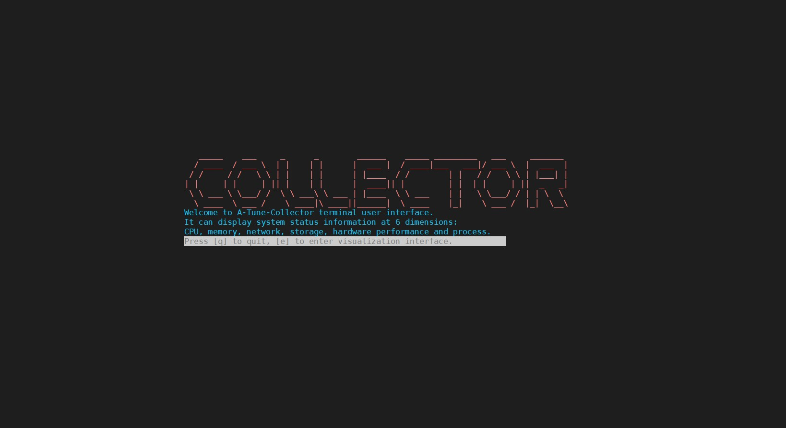
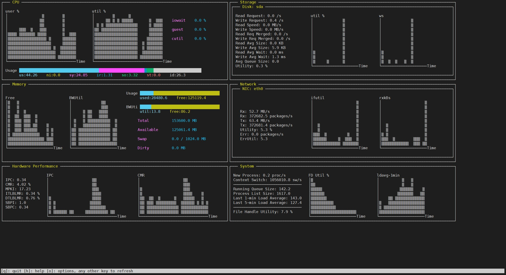

# A-Tune-Collector CLI

This feature is built on multi-dimensional data collected by A-Tune-Collector and supports CLI-based data visualization, including direct data display, data bars, and bar charts.

## Feature Description

The data collected by A-Tune-Collector is divided into six categories:

* CPU
* Memory
* Storage (hard drives)
* Network (NICs)
* Hardware performance (other hardware statistics, mainly CPU statistics, such as IPC and cache miss ratio)
* System (process information and file handles)

When used together with the collector tool, this feature provides an intuitive CLI-based visualization solution for large volumes of data.

It can also visualize all files collected and saved by the collector tool, facilitating manual analysis of performance bottlenecks.

## How to Use

### Method 1: Online collection and dynamic display

Go to the `ui` directory in atune_collector and run the following command:

```sh
python3 cli.py [-c ***.json]
```

| Optional Parameter    | Default Value                                | Description                      |
| ------------ | -------------------------------------- | -------------------------- |
| -c, --config | /etc/atune_collector/collect_data.json | JSON file configured for data collection.|

### Method 2: Offline collection and static display

Run the A-Tune-Collector. After the collection is complete, run the `cd` command to go to the `ui` directory in atune_collector.

```sh
python3 cli.py [-f ***.csv] [-c ***.json]
```

| Optional Parameter    | Default Value                                | Description                                                                 |
| ------------ | -------------------------------------- | --------------------------------------------------------------------- |
| -c, --config | /etc/atune_collector/collect_data.json | JSON file configured for data collection.                                           |
| -f, --file   | ./example/test.csv                     | CSV file that stores the collected data. The storage directory can be configured and viewed through the JSON file before the collection.|

Ensure that the collection items in the JSON configuration file are the same as those in the CSV file.

## Requirements for the Terminal

Ensure that the **terminal size is at least 200 × 50 (columns × rows)**. If the terminal is smaller than this requirement, a prompt will be displayed to request adjustment, after which the initialization screen will appear.



Press **e** to enter. Press **q** to exit.



The directly displayed data items and data bars represent the average values during the data collection process. Bar charts are generated based on the data of the corresponding items in each collection cycle.

## To Be Done

- Bar chart visualization items

  - Add axis ticks (on both the x-axis and y-axis).
  - Support using arrow keys to navigate and switch between charts.
  - When the data exceeds the display area, use the arrow keys to pan the bar chart view.
- Optimize the display of multi-NIC and multi-drive collection items.
- Support switching between different CSV files, allowing users to select the desired file.
- Portrait mode.
- Code refactoring and simplification.
- More function configuration options.
